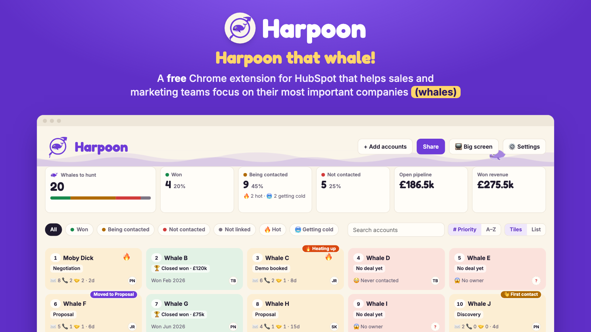
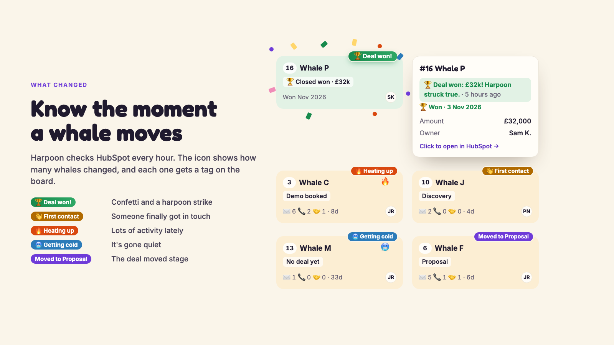
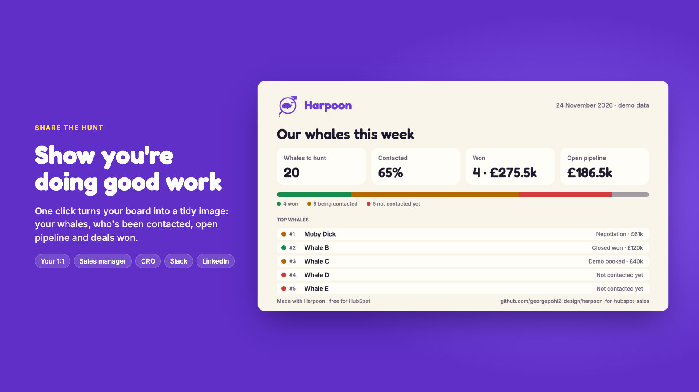
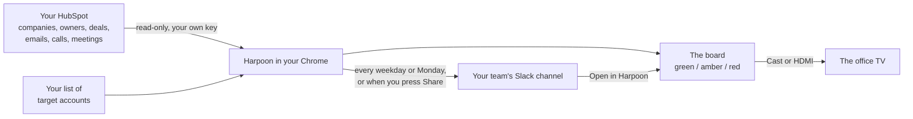

# Harpoon



### Harpoon that whale! 🐋

**Your top accounts on one board. A Slack nudge that gets sales on them.**

- **See every hunt at a glance:** your whales ranked from #1, the most important, green for won, amber for being contacted, red for nobody's on it.
- **Brief the crew on a schedule:** a Slack notification every morning or every Monday, saying who's doing what and who to go after next.
- **Put it on the office TV,** so the whole team can see it all day.

**Free.** A Chrome extension that reads from HubSpot, for a whole sales team or for one rep hunting their own whales. **[Try the demo in your browser →](https://georgepohl2-design.github.io/harpoon-for-hubspot-sales/board.html)** (made-up companies, nothing to install).

---

## The problem

In B2B, you already know your prey. It's the short list of companies you most want to win: your whales. Grab your harpoon.

(The fancy name is **account-based marketing**, or ABM: pick the accounts first, then aim sales and marketing at them together. ITSMA, a B2B services marketing association, coined the term in 2003–04, and big consulting firms such as Accenture were early adopters. Marketers who use it consistently rank it among the best-returning things they do.)

The trouble is keeping the hunt going. The target list lives in a spreadsheet or a HubSpot view nobody opens. Accounts sit untouched for months because nobody owns them. Others go cold after one email. Leaders only find out at the quarterly review.

I've built this by hand in past jobs: target-account visit alerts, red/amber/green follow-up rules, Slack lead cards. **Harpoon puts it in one place.** It shows every target account on one board, marks which ones nobody is working, and tells the team in Slack, by name, on a schedule.

**The job it does:** alert the commercial team, mostly sales, so they get on it.

## Who it's for

**Teams.** Founders, CROs, sales leaders, heads of marketing, commercial directors: anyone who runs a commercial team and needs to know, without opening ten HubSpot reports, whether the team is actually working the accounts that matter.

**Just you.** SDRs, BDRs, account executives and BD people working their own list of target accounts. Pick **Just me** when you set up, and Harpoon becomes your own board and your own weekly Slack recap: your whales, who you've contacted, your open pipeline and what you've won. Send the recap to yourself or to a channel your sales manager or CRO reads, copy it into an email, or bring the board up in your 1:1 or pipeline meeting. It shows, in one look, that you're on top of your accounts.

Simple enough that someone new to ABM gets it in a minute.

**It's free.** No paid plan, no account to sign up for.

## What it does

### 🐋 The board

Click the whale in Chrome's toolbar and the board opens in its own full-size tab: five tiles across on a 13-inch laptop, more on a bigger screen.

| Colour | Means |
|---|---|
| 🟢 **Won** | The company is a customer, or has a closed-won deal. |
| 🟠 **Being contacted** | Someone owns it and has logged at least one email, call or meeting. |
| 🔴 **Not contacted** | 😱 Nobody owns it, or 😳 someone owns it but nothing is logged yet. |
| ⚪ **Not linked** | You typed it in but it isn't matched to a HubSpot company yet. |

On each tile: ✉️ emails, 📞 calls and 🤝 meetings logged, the deal stage, and the owner. **🔥 Hot** means lots of recent contact; **🥶 Getting cold** means no touch for weeks. You choose the numbers in Settings.

- **Hover a tile** for the detail: emails, calls, meetings, last touch, owner, deal value, lifecycle stage, a deal-stage progress strip, and the latest touches from HubSpot.
- **Click a tile** to open that company in HubSpot.
- **🧭 Ship's log:** the newest emails, calls and meetings across all your target accounts.
- **Ranked by priority:** every whale has a number, and #1 is the one you want most. Drag a tile to re-rank, or type a new number in list view. Or sort A–Z.
- Stats across the top: how many whales you're hunting, won and contacted percentages, open pipeline, won revenue.
- Filter by colour, 🔥 or 🥶, search, or switch to a list view.
- **What changed:** the red number on the toolbar whale is how many whales have changed since you last looked. Each one gets a tag on its tile: **🏆 Deal won!**, **👋 First contact**, **🔥 Heating up**, **🥶 Getting cold** or **Moved to Proposal** (whatever the new deal stage is). The hover card says what it was before. A won deal gets the full celebration: a harpoon strikes the tile and the confetti flies. Hover the tile and it's marked as seen, or press **Mark all seen**. Harpoon checks HubSpot once an hour while Chrome is open, and doesn't count whales you've just added.



**100 whales is the max, but we recommend starting with 20.** Need more than 100? That's trawling, not harpooning. (Try adding number 101.)

**Hover the Harpoon logo** at the top of the board and watch what happens. Keep an eye on the waves along the top, too.

### 🎯 Adding your target accounts

Paste company names or websites (most important first), upload a CSV (a `Company name` column and an optional `Domain` column), or pull in every company already ticked "Target account" in HubSpot. Harpoon finds each one in HubSpot (website first, then name) and asks you to pick when two companies look alike.

### 🔔 The Slack notification

Press **Share** to see a preview, copy it into an email or Teams, send it now, or set it to go out automatically **every weekday morning** or **every Monday**. The Monday one looks like this:

```
🐋 Ahoy crew! Whales to hunt: 20
🟢 4 won / 🟠 9 being contacted / 🔴 5 not contacted so far
🔥 Hot: Moby Dick, Whale C
🥶 Getting cold: Whale M, Whale R

Who's doing what
• Priya N.: working 3, won 1 · biggest: Moby Dick, £61k in Negotiation
• Sam K.: working 2, won 1, 1 not contacted yet · biggest: Whale H, £28k in Proposal
• Tom B.: working 1, won 2, 1 not contacted yet · biggest: Whale L, £15.5k in Discovery
• Jess R.: working 3 · biggest: Whale C, £40k in Demo booked
• 😱 No owner: Whale E, Whale I, Whale Q

🎯 Next to hunt: #4 Whale D. Owned but never contacted. @Tom B. time to make first contact.

Open the target account list in Harpoon →
```

In **Just me** mode it says "Ahoy Captain! Your whales to hunt", adds your open pipeline and what you've won, and skips "Who's doing what" and the @-mentions.

(The weekday version skips "Who's doing what" to stay short. "Who's doing what" never goes past five lines. "Next to hunt" is your highest-ranked whale that nobody has contacted, nobody owns, or is getting cold.)

### 📸 Snapshot image

Also under **Share**: one tidy picture of the hunt, with your whales, how many you've contacted, what you've won, your open pipeline and your top five. Copy it or download it for your 1:1, your sales manager or CRO, or a LinkedIn post. Tick **Hide company names** before posting in public, and your top five become Whale #1 to #5.



### 📺 Big screen

Press **📺 Big screen** for TV mode: full screen, big text, no buttons, refreshing itself every 10 minutes. Then cast the tab to the office TV. Steps below.

## Install it (no coding needed, about 5 minutes)

It's not on the Chrome Web Store yet, so you load it yourself. It's easier than it sounds.

1. **Download it.** On this page, click the green **Code** button, then **Download ZIP**.
2. **Unzip it.** Double-click the downloaded file. You'll get a folder called `harpoon-for-hubspot-sales-main`.
3. **Open Chrome's extensions page.** Type `chrome://extensions` in the address bar and press Enter.
4. **Turn on Developer mode** with the switch in the top-right corner.
5. **Click "Load unpacked"** (top left) and choose the `harpoon-for-hubspot-sales-main` folder.
6. **Pin the whale.** Click the puzzle-piece icon next to the address bar, then the pin next to **Harpoon**.
7. **Click the whale.** The board opens in demo mode with 20 made-up whales (Moby Dick leads the pod), plus three welcome steps to get you set up: connect HubSpot, add your whales, set up Slack. Have a play.

To update later, download the ZIP again, replace the folder, and press ↻ on the Harpoon card in `chrome://extensions`.

## Connect HubSpot (read-only, about 5 minutes)

Harpoon only ever **reads** from HubSpot. It never creates, changes or deletes anything, and it never reads what an email says.

You'll need to be a HubSpot **Super Admin** to make the key. Not an admin (most SDRs and AEs aren't)? Send your admin these steps: it takes them 5 minutes, and the key can only read. Try it on a test account first if you like: a free HubSpot account with a few made-up companies works fine.

1. In HubSpot, open **Settings** (the cog) → **Integrations** → **Private Apps**. In some newer accounts it's under **Development → Legacy apps**.
2. Create a private app called **Harpoon**.
3. On the **Scopes** tab, tick these four, all **Read**:
   - `crm.objects.companies.read`
   - `crm.objects.deals.read`
   - `crm.objects.owners.read`
   - `crm.objects.contacts.read` (HubSpot uses this one to unlock emails, calls and meetings)
4. Create the app and copy its **access token**.
5. In Harpoon, open **⚙️ Settings**, paste the token and press **Test & connect**. It shows a ✅ or ❌ for companies, deals, owners, and emails, calls and meetings, so you can see if a scope is missing.
6. Press **+ Add accounts** and load your whales.

HubSpot sometimes moves these menus around. If a step doesn't match what you see, search HubSpot's help for "private apps".

## Connect Slack (about 3 minutes)

1. Go to **api.slack.com/apps** → **Create New App** → **From scratch**. Call it **Harpoon** and pick your workspace.
2. Open **Incoming Webhooks**, switch it on, and click **Add New Webhook to Workspace**.
3. Pick the channel (for example `#target-accounts`) and click **Allow**.
4. Copy the webhook link (it starts with `https://hooks.slack.com/`).
5. In Harpoon, open **⚙️ Settings**, paste it and press **Save & send test message**.
6. Press **Share** and choose when it goes out automatically.

**To really @-mention people:** in Slack, click a person's name → **⋮** → **Copy member ID**, and paste it next to their name in Settings. Without it, Harpoon just writes their name.

**Good to know:** the schedule runs inside Chrome, so it only goes out while Chrome is open on that computer. If Chrome was closed at the scheduled time, it goes out as soon as Chrome next opens.

## Put it on the office TV

1. Press **📺 Big screen**, then **Start TV mode**.
2. In Chrome, click the **⋮** menu (top right) → **Cast, save and share** → **Cast…**, and pick your TV. This works with TVs that have Chromecast or Google TV built in, or with a Chromecast plugged in.
3. Or skip casting: plug a spare laptop or a mini PC into the TV with an HDMI cable, install Harpoon there, and start TV mode.

Casting streams from the computer you cast from, so that computer has to stay on, awake and online, with Chrome open. For a screen that's always on, use a spare laptop or a mini PC that lives by the TV, and set it never to sleep. Press **Esc** to leave TV mode.

## How it works



- Everything runs in your own Chrome. There's no Harpoon server and no account to sign up for.
- Your HubSpot key, your Slack link and your list stay on your computer (see [PRIVACY.md](PRIVACY.md)).
- Tile colours follow four simple rules (the table above). Deal stage names come from your own HubSpot pipeline.

## Roadmap

- A proper **Connect to HubSpot** button (OAuth) instead of pasting a key.
- Notifications that go out even when your laptop is shut (needs a small server).
- A **"why now?"** line per account, written by AI from its recent activity.
- The Chrome Web Store, for one-click installs.

## Licence

© 2026 georgepohl2-design. **All rights reserved.** You're welcome to read the code and install Harpoon for your own use, but please don't copy, modify or republish it. See [LICENSE](LICENSE).

All companies and people in the demo are made up.
